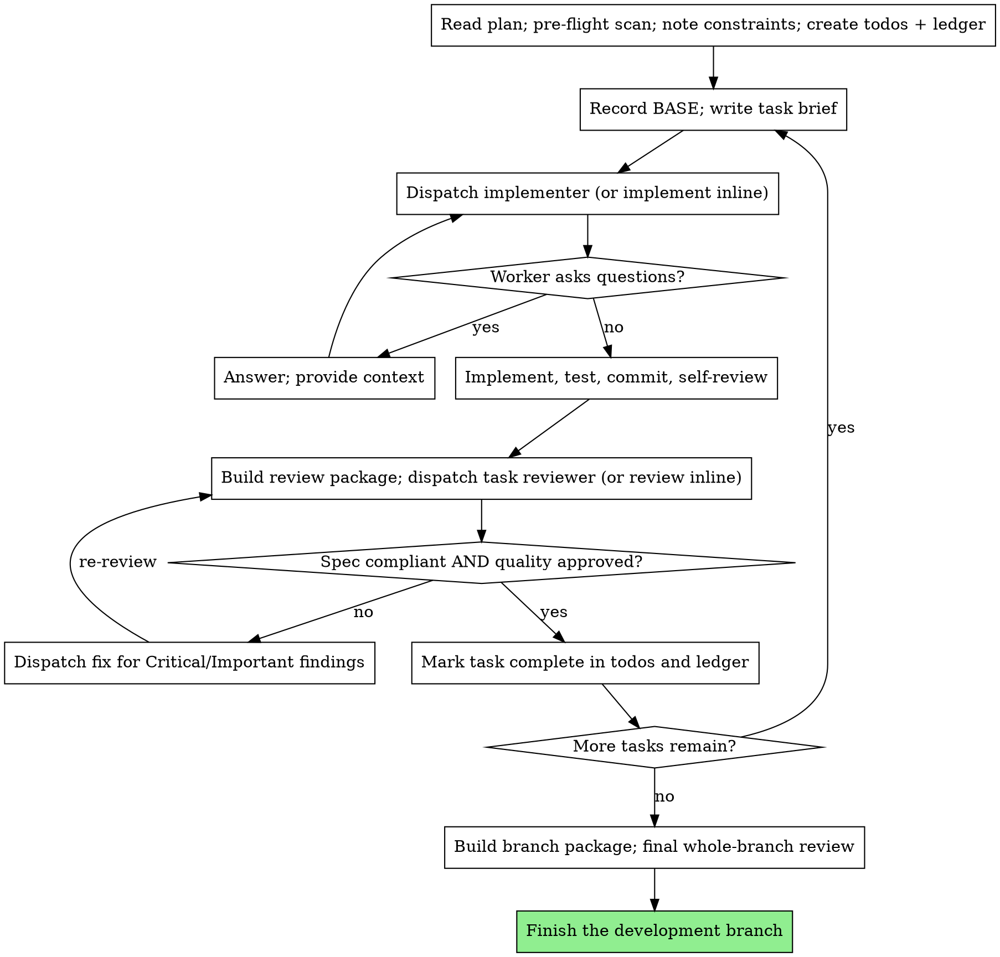

# Subagent-Driven Development

> Normative keywords — MUST, MUST NOT, REQUIRED, SHALL, SHALL NOT, SHOULD, SHOULD NOT, MAY — are used as defined in BCP 14 (RFC 2119, RFC 8174), and only when capitalized.

## Overview

- Host provides subagents (isolated-context worker agents you dispatch with a constructed prompt) → you MUST run each role — implementer, task reviewer, fix, final reviewer — as a fresh subagent.
- Host does NOT provide subagents → you MUST execute the same roles **inline, one task at a time, in the same order, with the same discipline**: implement the task, then deliberately switch to a reviewer stance and review it against the brief and the diff before touching the next task.
- Dispatch — dispatch as a subagent, or perform inline when subagents are unavailable.
- In subagent and inline modes → the review, the verification, and the per-task gate are REQUIRED.
- In subagent and inline modes → you MUST NOT skip the per-task review, collapse the spec-compliance and code-quality verdicts into one, or merge tasks to avoid a review.

## The Iron Law

```
NO TASK ADVANCES UNTIL ITS REVIEW IS CLEAN
```

The current task has an unresolved Critical or Important finding, a missing verdict, or an unverified spec requirement → you MUST NOT start a later task.

## When to Use

- Written implementation plan + tasks mostly independent + executing it in the current session → you MUST apply this skill.
- Tasks tightly coupled → you MUST NOT force this skill; sequence or re-decompose the plan first.

## Pre-Flight Plan Review (MANDATORY)

Pre-flight scan exemption — a plan written this session that `executing-plans` Step 1 exempts from another review.

Before Task 1, unless the pre-flight scan exemption applies → you MUST scan the whole plan once for:

- Tasks that contradict each other or the plan's stated global constraints.
- Anything the plan explicitly mandates that a competent review would treat as a defect.

- The scan finds anything → you MUST present them to the user as **one batched question** before execution begins, each finding beside the plan text that mandates it, asking which governs.
- During plan execution → you MUST NOT interrupt the user once per discovery.

## The Workspace (host-local, REQUIRED)

Scratch artifacts — task briefs, implementer reports, review packages, and the progress ledger.

Default scratch workspace — the following working-tree directory inside the host project:

```
<repo-root>/.omnipowers/sdd/
```

- `<repo-root>` — the host project's repository root, or your working directory when it is not a repo.
- The host declares a `scratch` location — an `Omnipowers` section in its `AGENTS.md` / `CLAUDE.md`, or in a document that file points to → you MUST use that instead, keeping the same `sdd/` layout underneath it.
- The directory does not exist → you MUST create it and write a self-ignoring `.gitignore` inside it (a single line containing `*`).
- For scratch artifacts → they MUST live in the working tree, never under `.git/`.
- When running this skill → you MUST NOT depend on any script, tool, or service outside the host project.

## File Handoffs (MANDATORY)

When handing over large artifacts, including in inline mode → you MUST write them to files instead of pasting text and Read them when switching stance.

For each task → you MUST produce and reuse these files under `.omnipowers/sdd/`:

- **Task brief** — `task-<N>-brief.md`: the task's full text extracted from the plan. Produce it by reading the plan and writing only that task's section to the brief file. Use the brief as the single source of requirements; copy the exact values (numbers, magic strings, signatures, test cases) verbatim from the plan into the brief, and include those values ONLY in the brief.
- **Report file** — `task-<N>-report.md`: write the full implementer report here and return only a short status summary; append fix reports (with test results) to this same file.
- **Review package** — `review-<base7>..<head7>.diff`: write the task's diff as a single file for the reviewer to read in one call; name each file per range, including re-reviews after fixes. When generating the review package → you MUST use the BASE recorded before the task started (see "Recording BASE"), never `HEAD~1`, with the following template:

  ```bash
  {
    echo "# Review package: BASE..HEAD"
    echo; echo "## Commits";       git log --oneline BASE..HEAD
    echo; echo "## Files changed";  git diff --stat BASE..HEAD
    echo; echo "## Diff";           git diff -U10 BASE..HEAD
  } > .omnipowers/sdd/review-<base7>..<head7>.diff
  ```

When constructing a later dispatch → you MUST NOT paste accumulated prior-task summaries ("state after Tasks 1–3").

## Recording BASE (MANDATORY)

Before starting each task → you MUST record the current commit as that task's BASE:

```bash
git rev-parse HEAD   # record this as BASE for Task N
```

When building a task's review package or citing its diff range to the reviewer → you MUST use the recorded BASE rather than `HEAD~1`.

## The Process



When dispatching implementers on the same working tree → you MUST NOT dispatch two in parallel.

## Worker Status Handling (MANDATORY)

When an implementer reports a status → you MUST handle it as follows:

- **DONE** → generate the review package from the recorded BASE and dispatch the task reviewer with the package path, the brief, and the report.
- **DONE_WITH_CONCERNS** → you MUST read the concerns before proceeding.
  - The concerns bear on correctness or scope → you MUST address them before review.
  - The concerns are observations → note them in the ledger and proceed to review.
- **NEEDS_CONTEXT** → you MUST provide the missing context and re-dispatch.
- **BLOCKED** → you MUST assess the blocker and act: (1) a context gap → provide more context and re-dispatch; (2) needs more reasoning → re-dispatch with a more capable model / more deliberate inline effort; (3) too large → split it into smaller pieces; (4) the plan itself is wrong → escalate to the user with the specifics.

A worker escalates → you MUST NOT ignore the escalation.

When retrying a task → you MUST NOT force the same model to retry it with no change.

A worker says it is stuck → something MUST change before the retry.

## Reviewer "⚠️ Cannot verify" Items (MANDATORY)

- "⚠️ Cannot verify from diff" items — requirements that live in unchanged code or span tasks.
- A requirement lives in unchanged code or spans tasks → a task reviewer MAY report it as a "⚠️ Cannot verify from diff" item.
- Before marking a task complete → you MUST resolve each "⚠️ Cannot verify from diff" item yourself.
- You confirm an item is a real gap → you MUST treat it as a failed spec review: send it back to the implementer and re-review.

## Constructing Review Prompts (MANDATORY constraints)

When constructing a review prompt or setting an inline reviewer stance → you MUST observe all of the following:

- You MUST NOT add open-ended directives without a concrete, task-specific reason.
- You MUST NOT ask the reviewer to re-run tests the implementer already ran on the same code.
- You MUST NOT pre-judge findings: never instruct a reviewer to ignore an issue, not flag something, or cap a severity. You believe a finding would be a false positive → you MUST let the reviewer raise it and adjudicate it in the loop.
- You MUST give the reviewer a **constraints block** copied verbatim from the plan's global-constraints section or the spec: exact values, exact formats, and stated relationships between components.
- You MUST hand the reviewer its diff as the review-package file path, not as pasted diff text.
- A plan-mandated finding, or any finding that conflicts with what the plan's text requires, is the user's decision → you MUST present the finding and the plan text and ask which governs. The plan mandates the finding → you MUST NOT dismiss it on that basis. A proposed fix contradicts the plan → you MUST NOT dispatch it without asking the user.

## Fix Dispatch Rules (MANDATORY)

- A review reports Critical or Important findings → you MUST dispatch a fix for every such finding.
- A review reports Minor findings → you MUST record them in the ledger and hand that list to the final whole-branch review to triage which Minors must be fixed before merge.
- When dispatching a fix → you MUST name the covering test files in the dispatch.
- Before re-dispatching the reviewer → you MUST confirm the fix report contains the covering tests, the command run, and the output.
- A fix landed → you MUST re-review the task before it advances.
- When accepting a fix → you MUST NOT rely on the fixer's report alone.
- The **final** whole-branch review returns findings → you MUST dispatch ONE fix worker with the complete findings list, not one fixer per finding.

## Model Selection

The host provides subagents with selectable models → you MUST specify the model explicitly on every dispatch.

**Model tiers** — mechanical implementation (isolated function, complete spec, 1–2 files): a fast, cheap model, the cheapest tier when the plan text contains the complete code; integration or judgment (multi-file coordination, pattern matching, debugging): a standard model; architecture, design, and the final whole-branch review: the most capable available model; reviews: a model matched to the diff's size, complexity, and risk.

- When selecting models for reviewers or implementers working from prose → you SHOULD use a mid-tier model as the floor.
- Inline (no-subagent) mode has no model to select → you MUST still scale your own effort the same way: minimal ceremony for transcription tasks, deliberate care for integration and design.

## Durable Progress (MANDATORY)

When executing the plan → you MUST track progress in a ledger file, not only in todos.

- At skill start → you MUST check for a ledger at `<repo-root>/.omnipowers/sdd/progress.md`.
- Tasks are marked complete in the ledger → you MUST NOT re-dispatch them; resume at the first task not marked complete.
- A task's review comes back clean → you MUST append one line to the ledger in the same step as your other bookkeeping:
  `Task N: complete (commits <base7>..<head7>, review clean)`.
- After any compaction or resume → you MUST trust the ledger and `git log` over your own recollection.
- `git clean -fdx` destroyed the ledger → you MUST recover the state from `git log` before dispatching anything.
- Authoritative progress record — the host's `work-state` document, located per `using-omnipowers`, rather than the ledger cache.
- Each task completes → you MUST update the authoritative progress record.

## Implementer Prompt Template — `@implementer-prompt.md`

You dispatch an implementer, or in inline mode start implementing a task → read `@implementer-prompt.md` and apply it, as the implementer's prompt or as your own implementation contract for the task.

## Task Reviewer Prompt Template — `@task-reviewer-prompt.md`

You dispatch a task reviewer, or in inline mode switch to the reviewer stance → read `@task-reviewer-prompt.md` and apply it, as the reviewer's prompt or as your reviewer stance.

When dispatching a fix → it MAY address spec gaps and quality findings together.

When re-reviewing after a fix → the re-review MUST cover both verdicts again.

## Final Whole-Branch Review (MANDATORY)

Every task is complete and clean → you MUST run one broad review across the entire branch.

When preparing the final whole-branch review → you MUST build a branch-wide review package from the branch's merge base:

```bash
git merge-base <base-branch> HEAD   # = MERGE_BASE (the commit the branch started from)
{
  echo "# Branch review package: MERGE_BASE..HEAD"
  echo; echo "## Commits";      git log --oneline MERGE_BASE..HEAD
  echo; echo "## Files changed"; git diff --stat MERGE_BASE..HEAD
  echo; echo "## Diff";          git diff -U10 MERGE_BASE..HEAD
} > .omnipowers/sdd/branch-review.diff
```

**Final review dispatch** — the most capable model, or your most deliberate inline stance, given the branch package path and the ledger's Minor-findings list; it evaluates the whole change for cross-task integration, contract consistency, and any defect that only emerges across tasks; its contract is the one in `@task-reviewer-prompt.md`, with the merge-base range as the diff and "merge review" rather than "task-scoped gate" as the scope.

- The final whole-branch review returns findings → you MUST resolve them per the Fix Dispatch Rules (one fix worker, complete list) and re-review before the branch is considered done.

**Branch-completion process** — `finishing-a-development-branch` when installed; otherwise the host project's own branch-completion process.

## Red Flags — STOP

When executing the plan → you MUST NOT:

- Start implementation on `main` / `master` without the user's explicit consent.
- Make a worker read the whole plan file — hand it its task brief instead.
- Omit scene-setting context.
- Ignore a worker's question — answer it completely before letting work proceed.
- Accept "close enough" on spec compliance.
- Let the implementer's self-review replace the task review.

For each task → the worker MUST understand where the task fits.

For each task → implementer self-review and task review are REQUIRED.

## Rationalizations — rejected

| Thought | What to do instead |
|--------|---------|
| "The task is tiny, skip the review" | Run the review. |
| "Both verdicts say roughly the same thing" | Produce both verdicts. |
| "I'll batch the reviews at the end" | Review each task before advancing to the next. |
| "Self-review already caught everything" | Run the task review as well. |
| "The plan mandates it, so it's fine" | Present the finding and the plan text to the user. |
| "I'll just re-run it without changing anything" | Change something before the retry. |
| "Pasting the prior summaries saves a step" | Hand artifacts over as files. |
| "HEAD~1 is close enough for the diff" | Use the recorded BASE. |
| "No subagents here, so the gates don't apply" | Run every gate inline, same rigor. |

## Verification Checklist

Before treating the plan as executed → you MUST be able to check every box:

- [ ] Pre-flight plan scan run; conflicts batched to the user or scan clean
- [ ] Ledger checked at start; no completed task re-dispatched
- [ ] BASE recorded before each task; review package built from it (never `HEAD~1`)
- [ ] Each task implemented, tested, committed, and self-reviewed before its review
- [ ] Each task reviewed with BOTH verdicts; review package handed as a file
- [ ] Every Critical/Important finding fixed and re-reviewed; ⚠️ items resolved
- [ ] Each clean task appended to the ledger
- [ ] Final whole-branch review run on the merge-base range, with the Minor list
- [ ] Final findings resolved via ONE fix worker and re-reviewed
- [ ] Branch finished per the host project's completion process

Any box is unchecked → you MUST close that gate before claiming completion.
