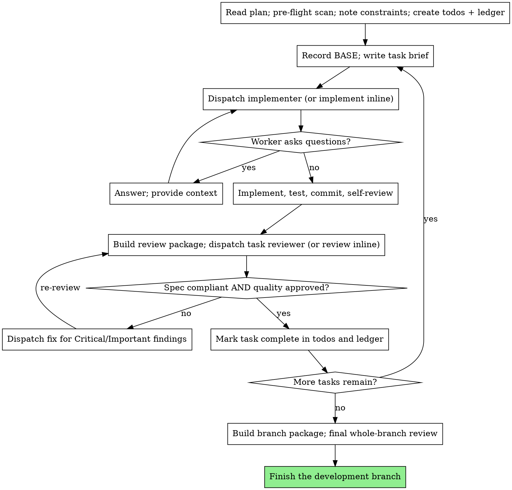

# subagent 驱动开发

> 本文中全大写的规范关键词 MUST、MUST NOT、REQUIRED、SHALL、SHALL NOT、SHOULD、SHOULD NOT、RECOMMENDED、MAY、OPTIONAL 按 BCP 14（RFC 2119、RFC 8174）解释，且仅在全大写时具有规范含义。

## 概览

- 宿主提供 subagent（你通过编写提示词派发、上下文互相隔离的工作 agent）→ 你 MUST 为每个角色 — 实现者、任务评审者、修复者、最终评审者 — 启动新的 subagent。
- 宿主不提供 subagent → 你 MUST **在当前会话内，逐个任务，按相同顺序和纪律**执行相同角色：实现任务，再有意识地切换到评审者立场，对照简报和 diff 评审，然后才能处理下一任务。
- 派发 — 派发为 subagent；没有 subagent 时在当前会话内执行。
- subagent 模式和当前会话模式下 → 评审、验证和逐任务闸门均为 REQUIRED。
- subagent 模式和当前会话模式下 → 你 MUST NOT 跳过逐任务评审、将规格符合性和代码质量结论合为一个，或合并任务以躲过评审。

## 铁律

```
任务评审未通过，任务就不能向前推进
```

当前任务有未解决的 Critical 或 Important 发现项、缺少结论或有未验证的规格要求 → 你 MUST NOT 开始后续任务。

## 何时使用

- 有书面的实现计划 + 任务大多独立 + 在当前会话中执行 → 你 MUST 应用本技能。
- 任务紧密耦合 → 你 MUST NOT 强行使用本技能；先安排执行顺序或重新分解计划。

## 执行前计划评审（MANDATORY）

执行前扫描豁免 — 本次会话编写、且 `executing-plans` 第 1 步豁免再次评审的计划。

任务 1 开始前，除非适用执行前扫描豁免 → 你 MUST 扫描整个计划一次，检查：

- 任务之间互相矛盾，或任务与计划声明的全局约束矛盾。
- 计划明确要求、但合格评审会视为缺陷的内容。

- 扫描有任何发现 → 你 MUST 在开始执行前，将发现项作为**一个合并的问题**呈现给用户；每项发现旁附上要求它的计划原文，询问以哪一方为准。
- 执行计划期间 → 你 MUST NOT 每发现一项就打断用户。

## 工作区（宿主本地，REQUIRED）

scratch 产物 — 任务简报、实现者报告、评审包和进度台账。

默认 scratch 工作区 — 宿主项目工作树内的以下目录：

```
<repo-root>/.omnipowers/sdd/
```

- `<repo-root>` — 宿主项目的仓库根目录；不是仓库时为工作目录。
- 宿主在 `AGENTS.md` / `CLAUDE.md` 的 `Omnipowers` 章节或文件指向的文档中声明了 `scratch` 位置 → 你 MUST 改用声明的位置，并在下面保留相同的 `sdd/` 布局。
- 目录不存在 → 你 MUST 创建目录，并在里面写入能忽略自身的 `.gitignore`（仅一行 `*`）。
- scratch 产物 → 它们 MUST 位于工作树内，不能放在 `.git/` 下。
- 运行本技能时 → 你 MUST NOT 依赖宿主项目以外的任何脚本、工具或服务。

## 文件交接（MANDATORY）

交接大体积产物时，包括当前会话模式 → 你 MUST 将产物写入文件，不粘贴文本，并在切换立场时读取文件。

每项任务 → 你 MUST 在 `.omnipowers/sdd/` 下生成并复用这些文件：

- **任务简报** — `task-<N>-brief.md`：从计划提取的完整任务原文。读取计划，只将此任务的章节写入简报文件。以简报作为要求的唯一来源；将精确值（数字、魔术字符串、签名、测试用例）从计划原样复制到简报中，只在简报内包含这些值。
- **报告文件** — `task-<N>-report.md`：在此写入完整的实现者报告，只返回简短状态总结；将修复报告（附测试结果）追加到同一文件。
- **评审包** — `review-<base7>..<head7>.diff`：将任务的 diff 写入单个文件，让评审者一次读取；按范围命名每个文件，修复后的复评也照做。生成评审包时 → 你 MUST 使用任务开始前记录的 BASE（见“记录 BASE”），不能用 `HEAD~1`，并使用以下模板：

  ```bash
  {
    echo "# Review package: BASE..HEAD"
    echo; echo "## Commits";       git log --oneline BASE..HEAD
    echo; echo "## Files changed";  git diff --stat BASE..HEAD
    echo; echo "## Diff";           git diff -U10 BASE..HEAD
  } > .omnipowers/sdd/review-<base7>..<head7>.diff
  ```

构造后续派发时 → 你 MUST NOT 粘贴累积的先前任务总结（“任务 1–3 后的状态”）。

## 记录 BASE（MANDATORY）

每项任务开始前 → 你 MUST 将当前提交记录为任务的 BASE：

```bash
git rev-parse HEAD   # record this as BASE for Task N
```

构建任务评审包或向评审者提供 diff 范围时 → 你 MUST 使用记录的 BASE，而非 `HEAD~1`。

## 流程



向同一工作树派发实现者时 → 你 MUST NOT 并行派发两个实现者。

## 工作者状态处理（MANDATORY）

实现者报告状态时 → 你 MUST 按以下方式处理：

- **DONE** → 从记录的 BASE 生成评审包，将评审包路径、简报和报告交给任务评审者。
- **DONE_WITH_CONCERNS** → 你 MUST 先读取疑虑，再继续。
  - 疑虑涉及正确性或范围 → 你 MUST 在评审前处理。
  - 疑虑属于观察结果 → 记入台账，再进入评审。
- **NEEDS_CONTEXT** → 你 MUST 补充缺失的上下文并重新派发。
- **BLOCKED** → 你 MUST 评估阻塞项并行动：(1) 上下文缺口 → 补充上下文并重新派发；(2) 要更深入的推理 → 使用更强模型 / 在当前会话内投入更审慎的推理后重新派发；(3) 任务过大 → 拆成更小的部分；(4) 计划本身错误 → 向用户升级求助并提供具体信息。

工作者升级求助 → 你 MUST NOT 忽略。

重试任务时 → 你 MUST NOT 不作任何改变就强迫同一模型重试。

工作者表示卡住 → 重试前 MUST 有所改变。

## 评审者的“⚠️ Cannot verify”项（MANDATORY）

- “⚠️ Cannot verify from diff”项 — 位于未变更代码中或跨越多个任务的要求。
- 要求位于未变更代码中或跨越多个任务 → 任务评审者 MAY 将它报告为“⚠️ Cannot verify from diff”项。
- 将任务标记为完成前 → 你 MUST 亲自解决每个“⚠️ Cannot verify from diff”项。
- 你确认某项确实是缺口 → 你 MUST 将它按规格评审失败处理：退回实现者并复评。

## 构造评审提示词（MANDATORY 约束）

构造评审提示词或在当前会话内设置评审者立场时 → 你 MUST 遵守以下全部规则：

- 没有具体、与任务相关的理由 → 你 MUST NOT 添加开放式指令。
- 实现者已在相同代码上运行过测试 → 你 MUST NOT 要求评审者重跑。
- 你 MUST NOT 预判发现项：不要指示评审者忽略问题、不标记某项内容或限制严重程度。你认为某个发现项会是误报 → 你 MUST 让评审者提出，再在评审循环中裁定。
- 你 MUST 向评审者提供从计划全局约束章节或规格中原样复制的**约束块**：精确值、精确格式、组件间已声明的关系。
- 你 MUST 以评审包文件路径交付 diff，不粘贴 diff 文本。
- 计划要求的发现项，或与计划原文要求相冲突的任何发现项，由用户决定 → 你 MUST 呈现发现项和计划原文，询问以哪一方为准。计划要求此发现项 → 你 MUST NOT 据此驳回。拟议修复与计划矛盾 → 你 MUST NOT 未询问用户就派发修复。

## 修复派发规则（MANDATORY）

- 评审报告了 Critical 或 Important 发现项 → 你 MUST 为每项发现派发修复。
- 评审报告了 Minor 发现项 → 你 MUST 将它们记入台账，并将列表交给最终全分支评审，以判定哪些 Minor 要在合并前修复。
- 派发修复时 → 你 MUST 在派发内容中列出覆盖测试文件。
- 重新派发评审者前 → 你 MUST 确认修复报告包含覆盖测试、运行的命令和输出。
- 修复已落地 → 你 MUST 复评任务后再推进。
- 接受修复时 → 你 MUST NOT 仅依赖修复者的报告。
- **最终**整个分支评审返回发现项 → 你 MUST 将完整发现项列表派发给一个修复工作者，不为每个发现项各派一个修复者。

## 模型选择

宿主提供能选择模型的 subagent → 你 MUST 在每次派发时显式指定模型。

**模型档位** — 机械实现（独立函数、完整规格、1–2 个文件）：快速低价模型，计划原文包含完整代码时选择最便宜档位；集成或判断（多文件协调、模式匹配、调试）：标准模型；架构、设计和最终全分支评审：可用的最强模型；评审：与 diff 的规模、复杂性和风险匹配的模型。

- 为依据文字工作的评审者或实现者选择模型时 → 你 SHOULD 至少使用中档模型。
- 当前会话（无 subagent）模式没有模型可选 → 你 MUST 仍按相同方式分配精力：抄录任务采用最少流程，集成和设计投入审慎思考。

## 持久进度（MANDATORY）

执行计划时 → 你 MUST 在台账文件中追踪进度，不能只靠待办列表。

- 技能开始时 → 你 MUST 检查 `<repo-root>/.omnipowers/sdd/progress.md` 是否存在台账。
- 台账已将任务标记为完成 → 你 MUST NOT 重新派发；从首个未标记完成的任务恢复。
- 任务评审通过 → 你 MUST 在处理其他记账事项的同一步中向台账追加一行：
  `任务 N：完成（提交 <base7>..<head7>，评审通过）`。
- 任何上下文压缩或恢复后 → 你 MUST 以台账和 `git log` 为准，而非自己的记忆。
- `git clean -fdx` 销毁了台账 → 你 MUST 在派发任何工作前从 `git log` 恢复状态。
- 权威进度记录 — 按 `using-omnipowers` 定位的宿主 `work-state` 文档，而非台账缓存。
- 每项任务完成 → 你 MUST 更新权威进度记录。

## 实现者提示词模板 — `@implementer-prompt.md`

派发实现者，或在当前会话模式中开始实现任务时 → 读 @implementer-prompt.md 并照做，将它用作实现者提示词或你自己的任务实现约定。

## 任务评审者提示词模板 — `@task-reviewer-prompt.md`

派发任务评审者，或在当前会话模式中切换到评审者立场时 → 读 @task-reviewer-prompt.md 并照做，将它用作评审者提示词或你的评审者立场。

派发修复时 → 修复 MAY 同时处理规格缺口和质量发现项。

修复后复评时 → 复评 MUST 再次覆盖两个结论。

## 最终全分支评审（MANDATORY）

每项任务均已完成且评审通过 → 你 MUST 对整个分支执行一次全面评审。

准备最终全分支评审时 → 你 MUST 从分支的合并基点构建覆盖整个分支的评审包：

```bash
git merge-base <base-branch> HEAD   # = MERGE_BASE (the commit the branch started from)
{
  echo "# Branch review package: MERGE_BASE..HEAD"
  echo; echo "## Commits";      git log --oneline MERGE_BASE..HEAD
  echo; echo "## Files changed"; git diff --stat MERGE_BASE..HEAD
  echo; echo "## Diff";          git diff -U10 MERGE_BASE..HEAD
} > .omnipowers/sdd/branch-review.diff
```

**最终评审派发** — 使用最强模型，或在当前会话内采取最审慎的立场；提供分支评审包路径和台账中的 Minor 发现项列表；评估整个变更中的跨任务集成、约定一致性，以及仅跨任务才显现的缺陷；评审约定见 `@task-reviewer-prompt.md`，diff 采用合并基点范围，范围采用“合并评审”而非“任务级闸门”。

- 最终全分支评审返回发现项 → 你 MUST 按修复派发规则解决（一个修复工作者、完整列表），并在判定分支完成前复评。

**分支完成流程** — 已安装时使用 `finishing-a-development-branch`；否则使用宿主项目自己的分支完成流程。

## 危险信号 — 停止

执行计划时 → 你 MUST NOT：

- 宿主的 `isolation` 声明和 `using-git-worktrees` 都没有放行时，就在 `main` / `master` 上开始实现。
- 让工作者读取整个计划文件 — 改为交给它任务简报。
- 省略背景上下文。
- 忽略工作者的问题 — 完整回答后再继续工作。
- 对规格符合性接受“差不多”。
- 让实现者的自我评审取代任务评审。

每项任务 → 工作者 MUST 理解任务在整体工作中的位置。

每项任务 → 实现者自我评审和任务评审均为 REQUIRED。

## 自我开脱 — 拒绝

| 想法 | 改做什么 |
|--------|---------|
| “任务很小，跳过评审” | 运行评审。 |
| “两个结论说的差不多” | 产出两个结论。 |
| “最后再一起评审” | 每项任务评审后再进入下一项。 |
| “自我评审已经找出所有问题” | 仍运行任务评审。 |
| “计划要求如此，没问题” | 将发现项和计划原文呈现给用户。 |
| “不作改变，直接再跑一次” | 重试前作出改变。 |
| “粘贴先前总结能省一步” | 通过文件交接产物。 |
| “用 HEAD~1 做 diff 也差不多” | 使用记录的 BASE。 |
| “这里没有 subagent，闸门不适用” | 在当前会话内以相同严谨程度运行每个闸门。 |

## 验证检查清单

将计划视为执行完成前 → 你 MUST 能勾选每一项：

- [ ] 已运行执行前计划扫描；冲突已合并向用户提出，或扫描未发现冲突
- [ ] 开始时已检查台账；未重新派发已完成任务
- [ ] 每项任务开始前已记录 BASE；评审包以此构建（从不用 `HEAD~1`）
- [ ] 每项任务在评审前已实现、测试、提交并完成自我评审
- [ ] 每项任务均已获得两个评审结论；评审包通过文件交付
- [ ] 每个 Critical/Important 发现项已修复并复评；⚠️ 项已解决
- [ ] 每个评审通过的任务已追加到台账
- [ ] 已基于合并基点范围运行最终全分支评审，并提供 Minor 列表
- [ ] 最终发现项已通过一个修复工作者解决并复评
- [ ] 已按宿主项目的完成流程完成分支

任何一项未勾选 → 你 MUST 通过相应闸门后再声明完成。
